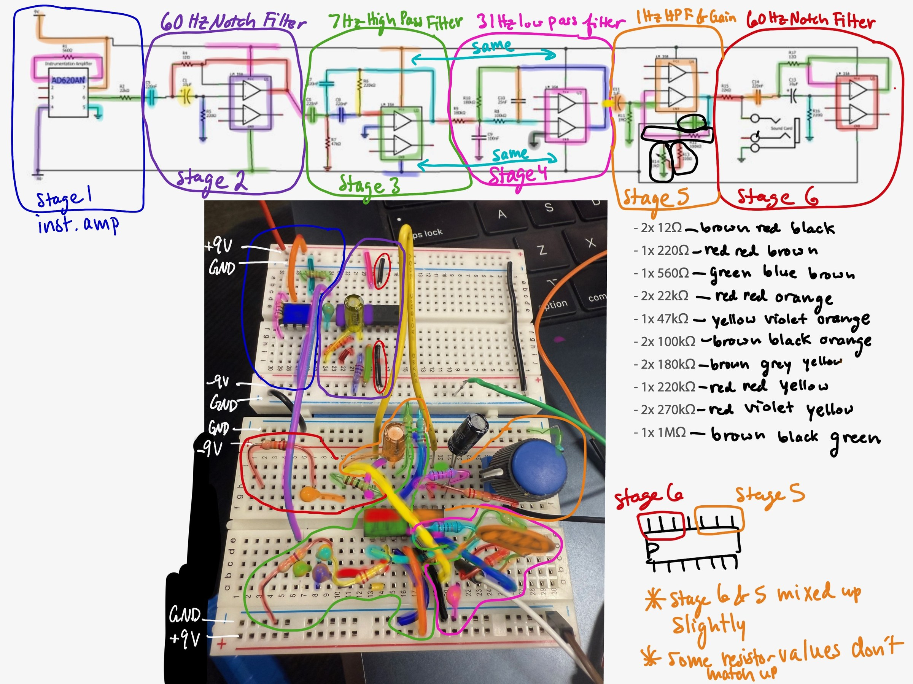
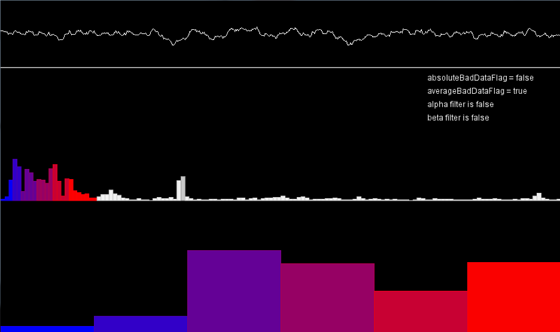
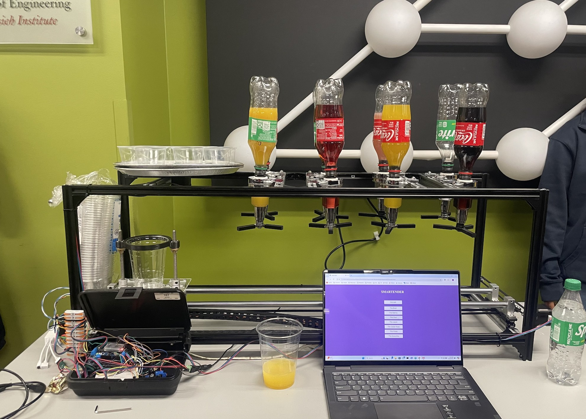
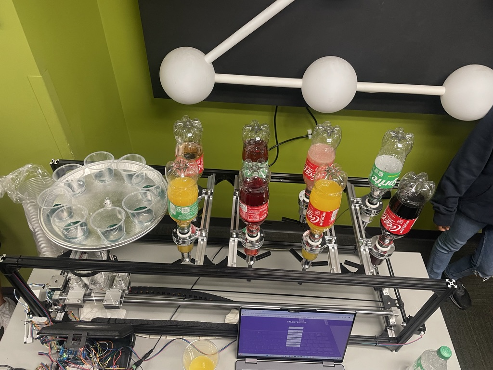
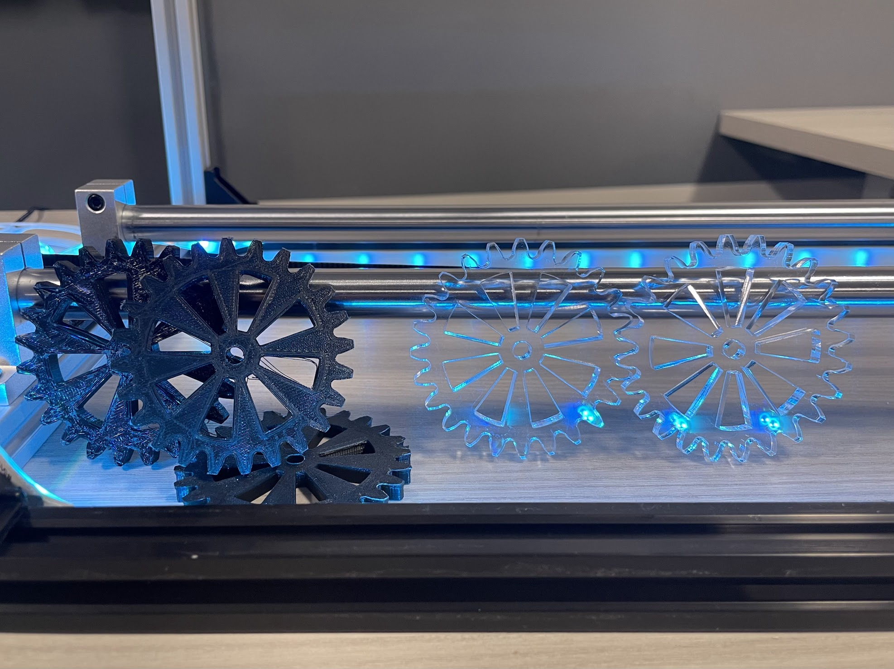

USC Makers is a university club that encourages students to build innovative and fun projects, fostering hands-on learning and creative problem-solving through engineering challenges.

The reason I love this club so much is that we **build** simply for the **fun of building**. Throw practicality out the window and just ***create***.

### Aeropet (Junior Year)

Aeropet is a drone that acts like a pet. Instead of a remote, you command it with hand gestures, which it recognizes using computer vision. And like any good pet, it gets attached: walk out of its sight and it develops separation anxiety, starting to cry and searching for you until it finds you again.

### BCD - Brain Controlled Drone (Sophomore Year)

During the 2024–25 school year, I made an EEG-controlled drone using a custom brain-computer interface.

We implemented drone flight commands trained on processed neural signals retrieved from the BCI.

### SmarTender (Freshman Year)

During the 2023–24 school year, I worked with my team to create an autonomous assembly line robot that dispenses and prepares beverages depending on user input.

We modeled its movement mechanisms after 3D printer linear rails and implemented different beverage combinations with an ice-dispensing function and some fun LEDS.

